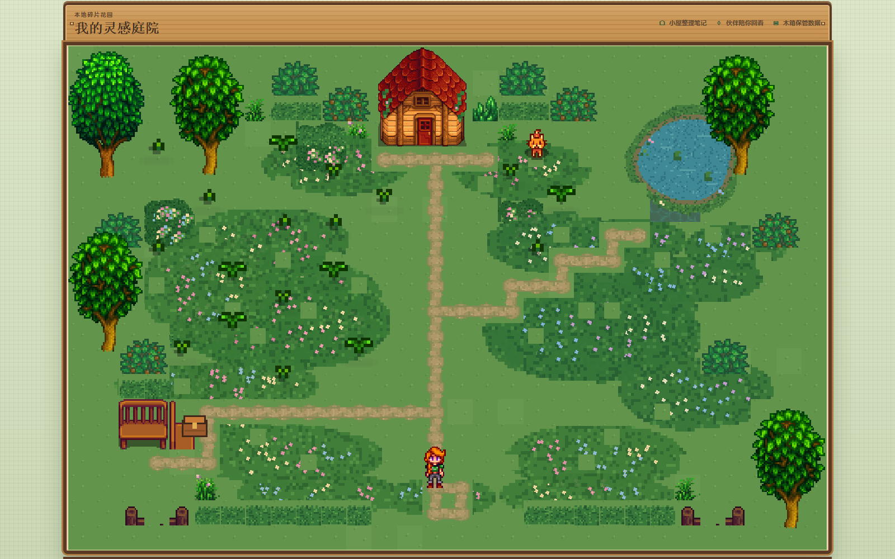
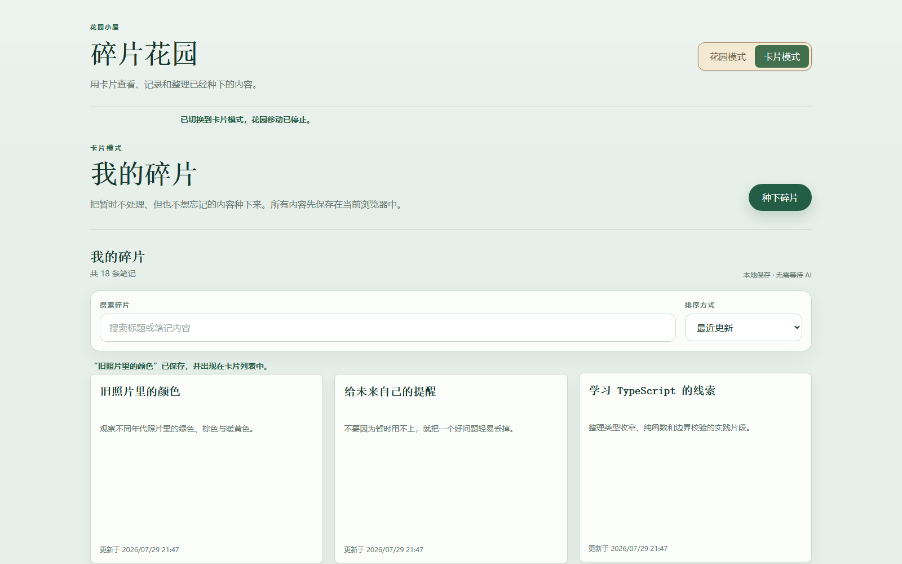
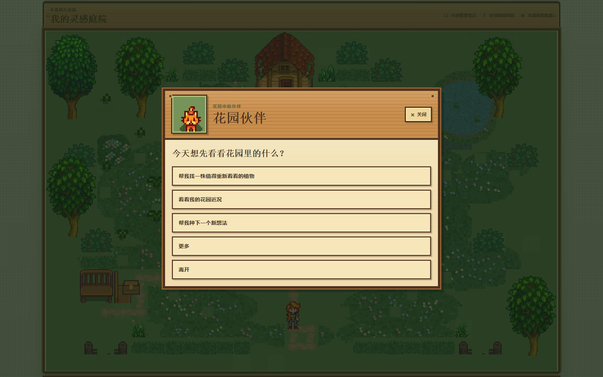

# 碎片花园（Fragment Garden）

> 把来不及整理的想法，种进一座会生长的私人像素花园。

碎片花园是一款面向中文用户、本地优先的桌面 Web 笔记工具。
文字、链接和图片不再只是列表中的收藏，而会成为花园里可以重新遇见、继续补充的植物。

当前仓库是第一代可体验版本，已经包含完整的记录、整理、回看、发芽和本地备份流程。



## 它解决什么问题

我们每天都会遇到值得保存的文章、截图、灵感和半成品，但不一定有时间立即分类整理。
普通收藏工具擅长“存下来”，却很难让旧内容再次回到视野中。

碎片花园把每篇笔记变成一株内容植物。内容积累会让庭院逐渐繁茂，而花园也会反过来提醒你：
这里还有一些过去种下、值得重新看看的想法。

## 四个核心能力

### 随手记录文字、链接和图片

文字笔记可以立即保存在本地。链接和图片会先完成内容处理，成功后才创建正式笔记和植物，
不会留下没有正文的空卡片。

### AI 整理为中文笔记

图片和链接默认整理为简体中文标题与 Markdown 正文。即使原始内容是英文，也会以中文总结为主，
同时保留产品名、代码、命令和必要的专有名词。

### 在花园里重新发现内容

每篇笔记稳定对应一株植物。你可以在庭院里散步，点击植物，让角色走近后打开对应笔记；
植物会随着补充、完成、休眠和恢复呈现不同状态。

### 将旧内容“发芽”为新笔记

“发芽”会根据一篇主体笔记和全部用户追加内容，生成一篇新的完整笔记草稿。
结果可以先预览和编辑，只有确认后才会创建新笔记、新植物和来源关系，原笔记始终保持不变。

## 两种互补的使用方式

卡片模式适合快速记录、搜索、阅读和编辑；花园模式负责空间感、成长反馈和重新发现。



花园伙伴是一位规则型 NPC，可以帮你查看庭院近况、寻找值得重看的植物，或开始种下一个新想法。
猫和狗只有外观不同，功能与规则完全一致。



> 截图来自真实运行页面，使用本地示例笔记，不包含真实个人数据或后期合成内容。

## 一次完整的使用流程

1. 写下一段文字，或提交一条链接、一张图片。
2. 内容成为可以阅读和编辑的正式笔记。
3. 笔记在花园中长成一株内容植物。
4. 日后添加独立的追加笔记，不覆盖原始正文。
5. 在卡片列表或花园中重新打开旧内容。
6. 需要继续发展时，生成并编辑“发芽”预览。
7. 确认后得到一篇新笔记，同时保留新旧笔记的来源关系。

## 数据与隐私

- 笔记、植物、关系和图片默认保存在当前浏览器的 IndexedDB。
- 当前没有账号、云同步或后台数据库，也不会自动上传整个花园。
- 完整备份可以导出并在另一个浏览器环境中预检、确认和恢复。
- API Key 只存在于本地服务端环境变量，不进入浏览器数据、备份或 Git。
- 清理浏览器站点数据或更换电脑前，请先导出备份。

## 本地运行

需要 Node.js 20.9.0 或更高版本，以及 npm。

```bash
git clone https://github.com/Zev55555/fragment-garden.git
cd fragment-garden
npm ci
npm run dev
```

打开 [http://localhost:3000/garden](http://localhost:3000/garden) 即可体验。

不配置第三方服务时，仍可使用文字笔记、卡片与花园、内容编辑、追加笔记、伙伴和备份恢复。

如需体验链接整理、图片分析和思维发芽，复制环境变量模板并按说明配置服务端参数：

```bash
cp .env.example .env.local
```

Windows PowerShell 可以使用：

```powershell
Copy-Item .env.example .env.local
```

不要提交 `.env.local`，也不要把 API Key 写进客户端代码。

## 第一代版本支持

- 文字、链接和单张 PNG/JPEG/WebP 图片输入
- 简体中文 AI 整理与安全 Markdown 阅读
- 主体笔记编辑和独立追加笔记
- 卡片搜索、统一尺寸列表与内容详情
- 近全屏像素庭院、角色移动和植物访问
- 三个内容植物家族与五个成长阶段
- 猫或狗花园伙伴
- 新植物种下、休眠、恢复和到达反馈
- 发芽预览、编辑、确认及新旧笔记双向访问
- 完整本地备份、预检和恢复

当前暂不支持：

- 账号、登录、云同步和跨设备自动同步
- 多人协作、社交和移动端适配
- 天气、季节、多地图、角色换装等完整农场玩法
- 面向普通用户的语音创建入口

## 技术概览

项目使用 TypeScript、Next.js App Router、React、Phaser 3.90、Dexie/IndexedDB、Zod、Vitest 和 Playwright。
React 管理产品界面，Phaser 管理花园场景，二者只通过类型安全的 GameBridge 通信。

## 开发文档

- [产品需求与详细范围](./PRD.md)
- [技术架构与数据模型](./ARCHITECTURE.md)
- [开发与协作规则](./AGENTS.md)
- [开发计划与完成记录](./DEVELOPMENT_PLAN.md)
- [花园视觉系统与当前限制](./docs/GARDEN_VISUAL_SYSTEM.md)
- [花园素材来源与裁切记录](./docs/GARDEN_ASSET_SOURCES.md)

## 素材与公开使用说明

当前像素花园使用了已记录来源的最小参考素材裁切集，用于个人、非商业作品集展示。
仓库不包含完整原始素材包；公开或商业化使用前，应替换为原创或具有明确再分发授权的素材。

本仓库未附加开源许可证。除非相应权利人另行授权，仓库公开可见不代表其中第三方素材可被复制或再分发。
