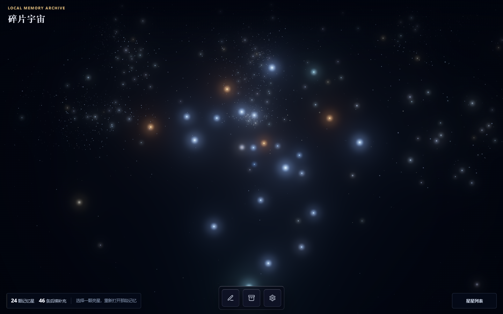
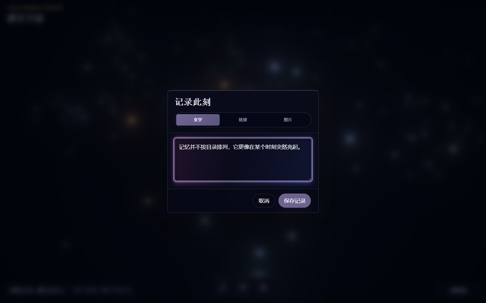
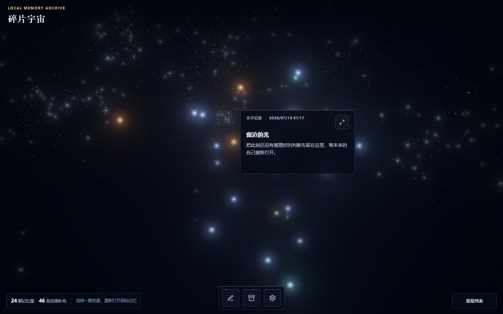
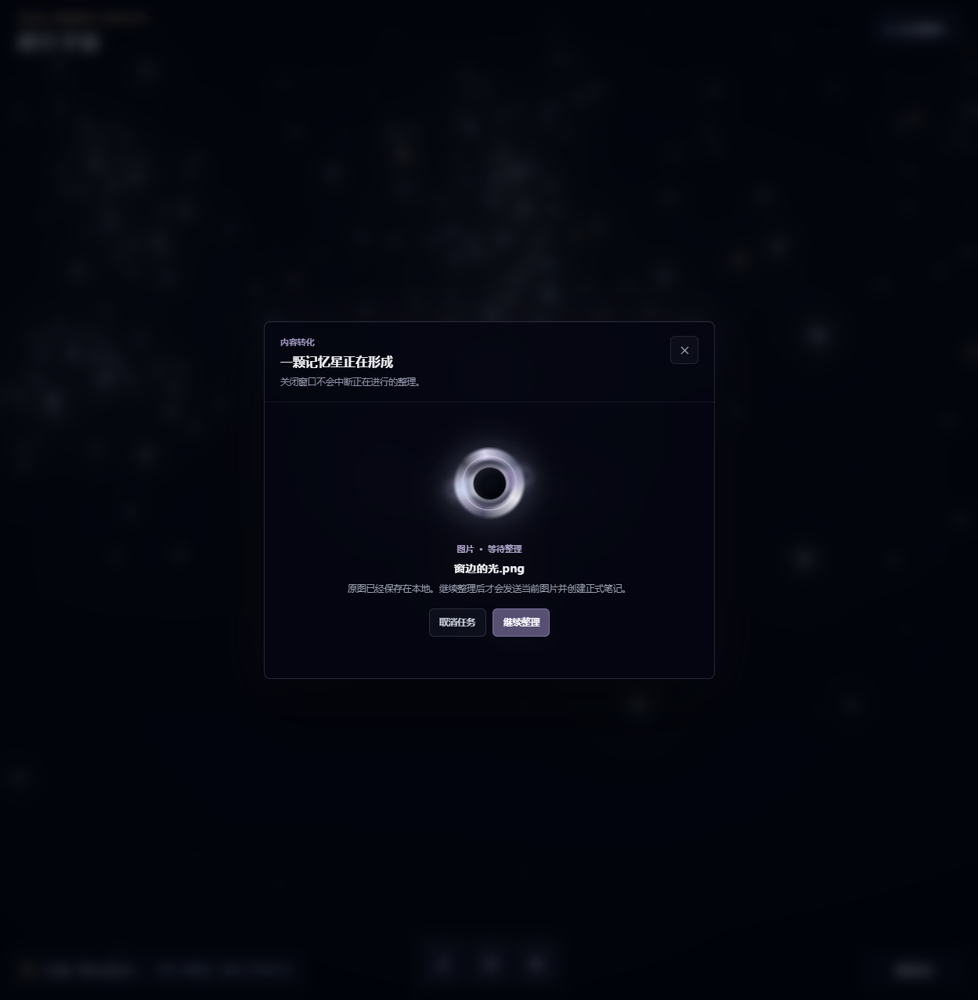

# 碎片宇宙 Fragment Universe

> 把来不及整理的文字、链接和图片，留在一片会随记忆逐渐点亮的私人星空里。

碎片宇宙是一款本地优先的个人记录工具。每条正式记录都会成为一颗位置稳定、可以重新打开的记忆星；每次追加补充都会让原来的星星更亮。记录越多，整片星空的运动会在克制的范围内逐渐加快。



## 核心体验

- **快速记录**：支持文字、网页链接和图片三种输入。
- **记忆成星**：只有内容真正保存成功后，星空才会点亮一颗可点击的内容星。
- **重新打开**：点击内容星先查看紧凑摘要，再平滑展开完整记录。
- **持续补充**：追加内容不会覆盖原文，并会提高对应星星的亮度。
- **稳定位置**：内容星坐标由 Fragment ID 确定性派生，刷新和备份恢复后保持一致。
- **本地优先**：正文、追加笔记、图片与任务状态默认保存在浏览器 IndexedDB。
- **完整备份**：设置中可以导出、预检并恢复本地数据。

## 产品画面

### 记录此刻

文字、链接与图片共享一套轻量的记录入口。文字在本地直接保存；链接和图片会在处理完成后再生成正式记录与记忆星。



### 查看与继续补充

点击内容星会打开星旁摘要卡。通过右上角的展开按钮进入完整详情，可查看原始内容、图片或链接结果，并继续追加笔记。



### 内容处理

链接读取与图片分析使用统一的黑洞等待态。任务可以转入后台；成功后落到对应的真实内容星，失败时保留可重试任务，不会创建虚假记录。



## 记录类型

### 文字

只需要输入正文。标题由第一行自动派生，但阅读界面不会重复显示与正文相同的标题。文字不依赖第三方服务，校验通过后立即写入本地数据库。

### 链接

可以粘贴纯 URL，也可以粘贴聊天软件生成的“说明文字 + URL”。客户端会提取第一个符合安全规则的公网 HTTP/HTTPS 地址，并允许添加可选备注。GetNote 成功返回内容后，才会原子创建正式记录和记忆星。

### 图片

支持单张 PNG、JPEG 或 WebP 图片，大小不超过 10 MB，可附加补充文字。图片先作为本地任务 Blob 保存，通过服务端 OpenAI Route 完成受约束的中文分析后，再原子创建正式记录、MediaAsset 与记忆星。

## 星空规则

- 环境星只构成空间氛围，不代表用户记录，也不可点击。
- 每个非 deleted 的正式 Fragment 最多对应一颗内容星。
- 星星坐标由 `fragmentId + layoutVersion` 的纯函数计算，不由 AI 决定。
- 追加数量通过有上限的饱和函数映射为亮度和轻微尺寸差异。
- 内容星数量通过有上限的函数影响整体旋转速度。
- 选中星星、打开详情或主动操作相机时，自动运动会减速或暂停。
- 开启 reduced motion 后，自动旋转、脉冲与形变停止，静态状态仍然可辨认。

## 技术栈

- Next.js App Router、React 19、TypeScript
- Three.js、OrbitControls、UnrealBloomPass
- Dexie / IndexedDB
- Zod、Vitest、Playwright
- OpenAI Responses API（图片分析）
- GetNote（网页链接读取）

Three.js 只负责星空渲染、命中检测和受限的 `fragmentId` 回调。它不会读取正文、IndexedDB、图片 Blob 或 Provider 凭证；React 与本地 Service 负责内容和交互，Domain 纯函数负责稳定坐标、亮度和转速规则。

## 本地运行

需要 Node.js 20.9.0 或更高版本，以及 npm。

```bash
git clone https://github.com/Zev55555/fragment-universe.git
cd fragment-universe
npm ci
npm run dev
```

打开 [http://localhost:3000](http://localhost:3000)。

未配置第三方 Provider 时，文字记录、星空浏览、追加笔记与数据备份仍可正常使用。

## Provider 配置

复制变量模板：

```bash
cp .env.example .env.local
```

Windows PowerShell：

```powershell
Copy-Item .env.example .env.local
```

链接读取需要：

- `GETNOTE_API_KEY`
- `GETNOTE_CLIENT_ID`
- `GETNOTE_LINK_IMPORT_ENABLED=true`

图片分析需要：

- `OPENAI_API_KEY`
- `OPENAI_IMAGE_ANALYSIS_ENABLED=true`
- `OPENAI_IMAGE_MODEL`

所有 Key 只允许存在于服务端环境变量或 `.env.local`。不要提交 `.env.local`，也不要给任何变量添加 `NEXT_PUBLIC_` 前缀。

## 数据与隐私

- 当前版本没有注册、登录、云同步或后台内容数据库。
- 用户数据默认保存在当前浏览器的 IndexedDB。
- 链接只在用户提交后发送给 GetNote；图片只在用户确认披露后发送到 OpenAI 分析 Route。
- 星空渲染层不会接收正文、图片、链接内容或密钥。
- 清理浏览器站点数据或更换设备前，请先在设置中导出备份。

## 质量检查

```bash
npm run format:check
npm run typecheck
npm run lint
npm run test
npm run build
npm run test:e2e
```

自动化测试使用 Mock Provider，不会调用真实 OpenAI 或 GetNote 服务。

## 项目文档

- [产品需求](./PRD.md)
- [技术架构](./ARCHITECTURE.md)
- [星空渲染与交互系统](./docs/MEMORY_STARMAP_SYSTEM.md)
- [协作规范](./AGENTS.md)
- [Git 工作流](./GIT_WORKFLOW.md)

## 当前范围

V1 聚焦“记录 → 点亮 → 回看 → 追加”的最小闭环。星座、关系线、语义聚类、AI 推荐、社交、账号与云同步均不在当前范围内。

## License

当前仓库用于个人项目与作品展示。若计划将其用于商业发行，请先补充明确的软件许可，并重新核验第三方服务条款与所有素材许可。
